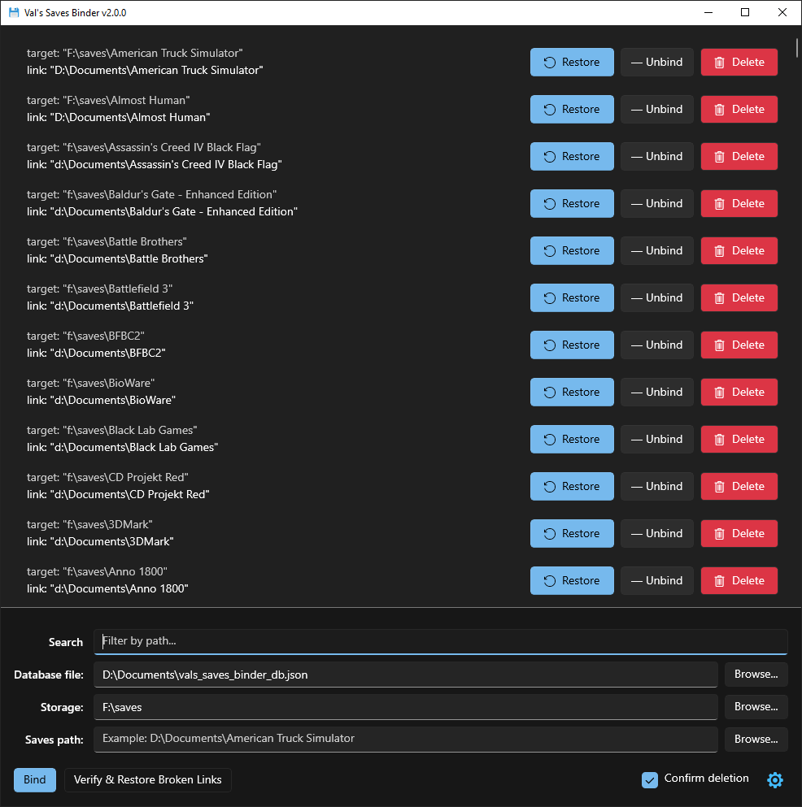

# SavesBinder

[](https://www.microsoft.com/windows)
[](https://dotnet.microsoft.com/)
[](https://learn.microsoft.com/windows/apps/windows-app-sdk/)
[](LICENSE)

A lightweight Windows tool to centralize your game saves using NTFS directory junctions.

Move your saves to a single, safe location while keeping the original paths fully functional. Built with C#, WinUI 3 and Windows App SDK.

*Created by a gamer, for gamers :3*

## Why SavesBinder?

Games scatter save files all over the place: `Documents`, `AppData\Roaming`, `AppData\Local`, custom folders, etc.

**SavesBinder** lets you gather all of them into one clean folder for easy backup. Using NTFS junctions, games keep reading and writing to their original paths without even knowing anything changed.

## Features

- **Easy binding** – Move a game's save folder to your central storage and leave a working junction in its place.
- **Centralized storage** – Keep all your saves in one dedicated directory.
- **Broken link detection** – Use "Verify & Restore Broken Links" to quickly repair junctions after reinstalling Windows or changing drives.
- **Native NTFS junctions** – Uses Windows directory junctions (`mklink /J`). No admin rights required.
- **Portable** – Put the entire app folder anywhere and run `SavesBinder.exe`. Settings are stored in `settings.json` next to it.
- **Safe by design** – Built-in confirmations, path validation, nesting checks, disk space checks and rollback on failure.
- **Bilingual UI** – Russian and English.
- **Clean WinUI 3 interface** – Modern, minimal and easy to use.

## How It Works

```text
[Original Path] (e.g. %APPDATA%\Game) ──(move files)──> [Central Storage] (e.g. D:\GameSaves\Game)
                │                                        ▲
                └──────────(NTFS junction)───────────────┘
```

1. Set your **Database file** (simple JSON), **Central storage folder** and the game's current save path.
2. Click **Bind**. SavesBinder moves the folder to storage and creates a junction at the original location.
3. The game works as before. Your saves are now in one place.

## Requirements

- **Windows 10 22H2 / Windows 11**
- **NTFS** formatted drives
- **[.NET 8 Desktop Runtime](https://dotnet.microsoft.com/download/dotnet/8.0)** (if not present)
- **[Windows App Runtime 2.5](https://learn.microsoft.com/windows/apps/windows-app-sdk/downloads)** (if not present)

## Download & Usage

### Pre-built (recommended)

1. Go to the [Releases](https://github.com/valsaven/SavesBinder/releases) page.
2. Download the latest `.zip` archive (portable folder).
3. Extract it anywhere (e.g. `D:\Tools\SavesBinder\`).
4. Run `SavesBinder.exe`.

### Build from source

Prerequisites:
- [Visual Studio 2022](https://visualstudio.microsoft.com/) with **.NET Desktop Development** and **Windows App SDK** workloads
- Or CLI with `dotnet` SDK

```bash
git clone https://github.com/valsaven/SavesBinder.git
cd SavesBinder
dotnet restore
dotnet build SavesBinder.csproj -p:Platform=x64
```

To create a portable publish:

```bash
dotnet publish SavesBinder.csproj -c Release -p:Platform=x64
```

The output will be in `bin\Release\net8.0-windows10.0.19041.0\win-x64\publish\`.

## Important Notes

- This tool uses **directory junctions**. They only work on **NTFS** volumes.
- Always make a quick backup of important saves before binding them for the first time.
- **Do not delete junctions manually in File Explorer.** Use **Unbind**, **Restore** or **Delete** in the app to avoid data loss.
- Use **Verify & Restore Broken Links** after reinstalling Windows, moving drives or restoring from backup.
- If you run the app from a read-only location (like `Program Files`), `settings.json` will not be saved.
- The app is **portable** — moving the whole folder keeps your settings and DB file if paths are relative or unchanged.

## Screenshots



## License

This project is licensed under the [MIT License](LICENSE).
